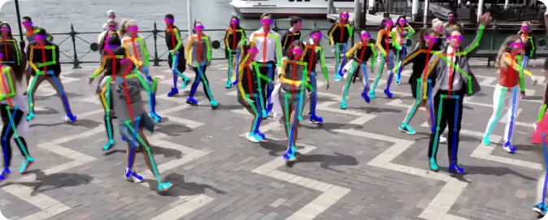
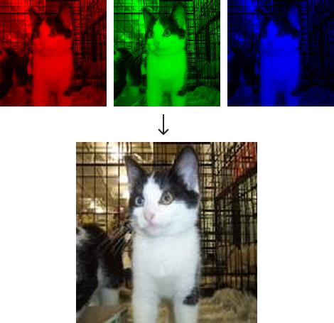
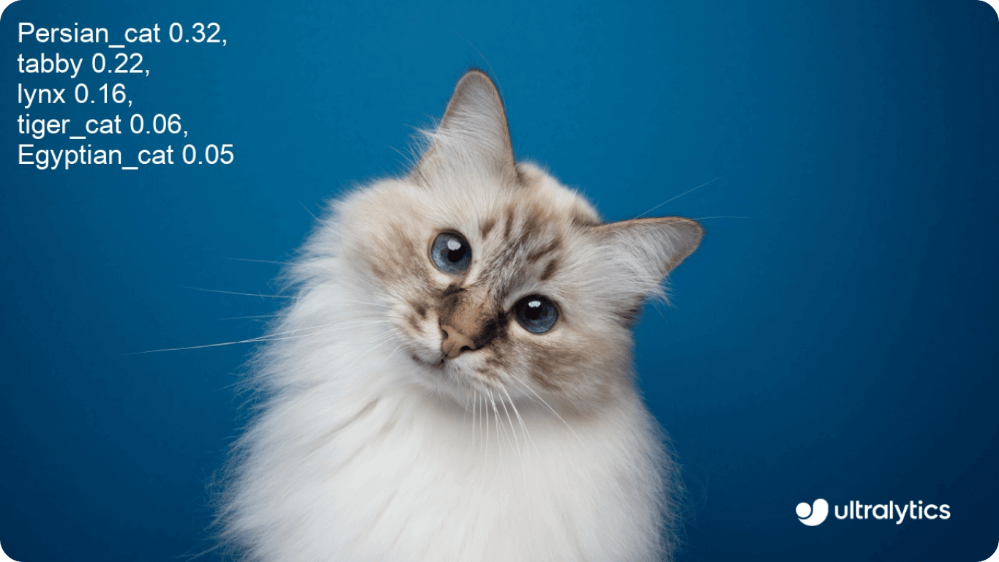
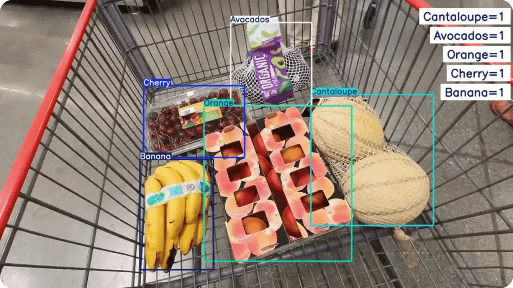
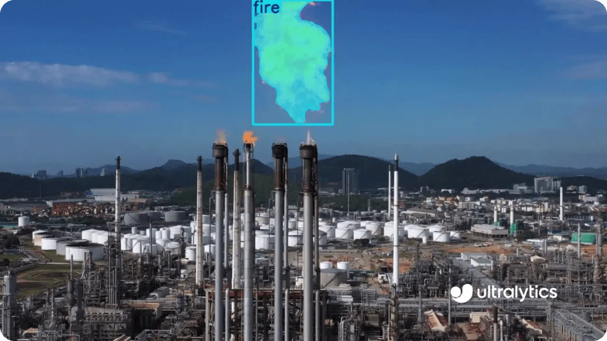

::title::

# コンピュータビジョンの3大タスクを体験する

::date::

体験授業

---
layout: toc
hideInToc: true
---

::title::

# 目次

::default::

<Toc minDepth="1" maxDepth="1" />

---
layout: section
section: '01'
level: 1
---

# 今日のゴール

---
layout: default
title: 今日のゴール
level: 2
---

今日はAIを自分で作るのではなく、すでに学習された画像AIを使って、結果の違いを体験する

### できるようになること

- コンピュータビジョンが何をする技術か説明できる
- 画像がコンピュータの中では数字として扱われることを理解する
- 分類・検出・分割の違いを、実行結果を見て説明できる
- 目的に合わせて、どのタスクを使うか考えられる

---
layout: section
section: '02'
level: 1
---

# 最小限の基礎知識

---
layout: n-columns
columns: 2
gap: 32
title: コンピュータビジョン (CV) とは
level: 2
---

**画像や動画をコンピュータに理解させる技術**

人間は写真を見て、すぐに「人がいる」「車がある」「歩いている」と判断できる。コンピュータにも同じような判断を行わせる

### 使われている例

- 顔認証 / 顔認識
- 自動運転システム
- 工場での不良品検知

::column-2::

<figure class="flex h-full flex-col items-center justify-center">
  
  <figcaption>図1 人物姿勢推定（引用: Ultralytics）</figcaption>
</figure>

---
layout: n-columns
columns: 2
gap: 32
title: コンピュータにとって画像とは
level: 2
---

コンピュータは画像を「意味」ではなく **「数字」** として見ている。画像は小さな点（ピクセル）の集まり

### グレースケール画像

- 各ピクセルに0〜255の数字が入る
- 0は黒、255は白に近い

### カラー画像 (RGB)

- R, G, Bの3つの数字で色を表す

::column-2::

<figure class="flex h-full flex-col items-center justify-center">
  
  <figcaption>図2 赤・緑・青の層が重なって画像になる様子</figcaption>
</figure>

---
layout: default
title: 画像AIは何を返すのか
level: 2
---

画像を入力すると、目的に合わせた結果が返ってくる

  

    <h3>入力</h3>
    
画像・動画・カメラ映像

  

  
→

  

    <h3>モデル</h3>
    
画像の中の特徴を見つけて、目的に合わせて判断する

  

  
→

  

    <h3>出力</h3>
    
ラベル、位置、領域など

  

---
layout: section
section: '03'
level: 1
---

# CVの3大タスク

---
layout: default
title: 今日体験する3大タスク
level: 2
---

同じ画像でも、「何を知りたいか」によって使うタスクが変わる

| タスク | 答える質問 | 出力 |
|--------|------------|------|
| **分類** | 何が写っている？ | カテゴリラベル |
| **検出** | どこに何がある？ | 物体の位置 + ラベル |
| **分割** | どの部分が対象？ | ピクセルごとの領域 |

::conc::

今日はColabでこの3つを順番に実行し、結果を比べる

---
layout: default
title: 3大タスクの使い分け
level: 2
---

| 知りたいこと | 選ぶタスク | 出力のイメージ | 具体例 |
|--------------|------------|----------------|--------|
| 画像に何が写っているか | 分類 | 「猫」 | 商品カテゴリ判定 |
| どこに写っているか | 検出 | 四角い枠 + 「人」 | 防犯カメラの人数確認 |
| どの領域が対象か | 分割 | 対象ピクセルの塗り分け | 道路・歩道・車線の認識 |

::conc::

分類から分割へ進むほど、出力は細かくなる

---
layout: n-columns
columns: 2
gap: 32
title: 分類 (Classification)
level: 2
---

**画像全体を1つのカテゴリに分ける**

### 答える質問

- この画像は何か？
- 一番近いカテゴリは何か？

### Colabで見るポイント

- 予測されたラベルと確信度
- 複数の物体があるときに何を選ぶか

::column-2::

<figure class="flex h-full flex-col items-center justify-center">
  
  <figcaption>図3 画像分類の例（引用: Ultralytics）</figcaption>
</figure>

---
layout: n-columns
columns: 2
gap: 32
title: 検出 (Detection)
level: 2
---

**画像内の物体の位置と種類を見つける**

### 答える質問

- どこにあるか？ それは何か？ いくつあるか？

### Colabで見るポイント

- 枠の位置が合っているか
- 見逃している物体はないか
- 間違って検出していないか

::column-2::

<figure class="flex h-full flex-col items-center justify-center">
  
  <figcaption>図4 物体検出の例（引用: Ultralytics）</figcaption>
</figure>

---
layout: n-columns
columns: 2
gap: 32
title: 分割 (Segmentation)
level: 2
---

**画像の中の対象領域を細かく分ける**

### 答える質問

- どの部分が対象か？ 境界はどこか？

### Colabで見るポイント

- 対象の形に沿って塗られているか
- 境界がずれていないか
- 小さい部分が消えていないか

::column-2::

<figure class="flex h-full flex-col items-center justify-center">
  
  <figcaption>図5 セグメンテーションの例（引用: Ultralytics）</figcaption>
</figure>

---
layout: default
title: 同じ画像で比べる
level: 2
---

Colabでは、同じ画像を3つのタスクに入れて、返ってくる結果を比べる

| タスク | 見るもの | 例 |
|--------|----------|----|
| 分類 | 画像全体のラベル | 「犬」「車」「料理」 |
| 検出 | 物体ごとの枠とラベル | 「人」が3人、「車」が2台 |
| 分割 | 対象の形に沿った領域 | 人や車の部分だけが塗られる |

::conc::

大事なのは「どれが一番すごいか」ではなく、目的に合う出力を選ぶこと

---
layout: section
section: '04'
level: 1
---

# タスクの体験

---
layout: default
title: タスクの体験 (Google Colab)
level: 2
---

このスライドを開く: **micanis.github.io/mySlide/trial-class/#/17**

<a href="https://colab.research.google.com/github/micanis/mySlide/blob/main/decks/trial-class/python/dot_ipynbs/experience.ipynb" target="_blank" rel="noopener noreferrer" class="my-6 inline-flex items-center gap-3 rounded-md !bg-[var(--micanis-accent)] px-6 py-3 text-2xl font-bold !text-white !no-underline">
  Colabで開く →
</a>

1. 上のボタンをクリック
2. 「ドライブにコピー」で自分のアカウントに保存（任意）
3. 上から順にセルを実行していく

---
layout: n-columns
columns: 2
gap: 40
title: 体験ミッション
level: 2
---

### ミッション

1. はっきりした画像で試す
2. 少し難しそうな画像で試す
3. 分類・検出・分割の結果の違いを見る
4. うまくいったところ、間違えたところをメモする

::column-2::

### 難しそうな画像の例

- 小さい物体が写っている
- 暗い、ぶれている、隠れている
- たくさんの物体が同時に写っている

::conc::

結果を出すだけでなく「違い」と「間違い」を探す

---
layout: default
title: 体験で見るポイント
level: 2
---

| 確認すること | 見るポイント |
|--------------|--------------|
| 入力画像 | 人間には簡単に見えるか |
| 分類結果 | 画像全体を何だと判断したか |
| 検出結果 | 枠の位置、数、ラベルは合っているか |
| 分割結果 | 対象の形に沿って塗られているか |
| 間違い | どんな画像で失敗しやすいか |

::conc::

「どんな時に外れるか」を見ると、実用化の課題が見えやすい

---
layout: default
title: ふりかえり
level: 2
---

次の場面では、どのタスクを使うとよさそうか考えてみよう

| やりたいこと | 使うタスク |
|--------------|------------|
| 写真が食べ物かどうかを判断したい | 分類 |
| 防犯カメラで人の数を数えたい | 検出 |
| 道路の画像から車道だけを取り出したい | 分割 |

::conc::

自分なら、分類・検出・分割を何に使ってみたいか？

---
layout: default
title: まとめ
level: 2
---

- コンピュータビジョンは、画像や動画をコンピュータに理解させる技術
- 画像はコンピュータの中では数字の集まりとして扱われる
- 分類は「何が写っているか」を答える
- 検出は「どこに何があるか」を答える
- 分割は「どの部分が対象か」を答える

::conc::

目的に合わせて、必要な出力を選ぶことが大切

---
layout: default
title: 参考文献
level: 2
hideInToc: true
---

| 図 | 出典 |
|----|------|
| 図1 | Ultralytics Blog - [What is OpenPose](https://www.ultralytics.com/ja/blog/what-is-openpose-exploring-a-milestone-in-pose-estimation) |
| 図2 | 自作 |
| 図3 | Ultralytics Blog - [Image Classification](https://www.ultralytics.com/ja/blog/how-to-use-ultralytics-yolo11-for-image-classification) |
| 図4 | Ultralytics Blog - [Object Detection Models](https://www.ultralytics.com/ja/blog/the-best-object-detection-models-of-2025) |
| 図5 | Ultralytics Blog - [Instance Segmentation](https://www.ultralytics.com/ja/blog/how-to-use-ultralytics-yolo11-for-instance-segmentation) |
